# Continuation before / after

Baseline: PR #10 head `4e09f73`. After: continuation implementation in this PR (the capture manifest records the local source commit; the published branch contains the same source). Feeds are deterministic fallbacks; no real journal data is shown.

Six routes at desktop and mobile widths are previewed below. The separate review ZIP includes 144 lossless viewport/full-page captures across all six viewport sizes plus an offline gallery. CI also uploads exact-head captures and real 200% zoom evidence.

## compare · desktop

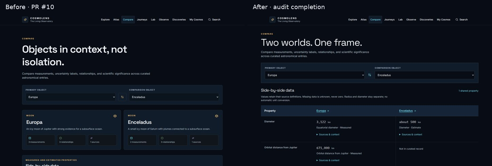

## compare · mobile

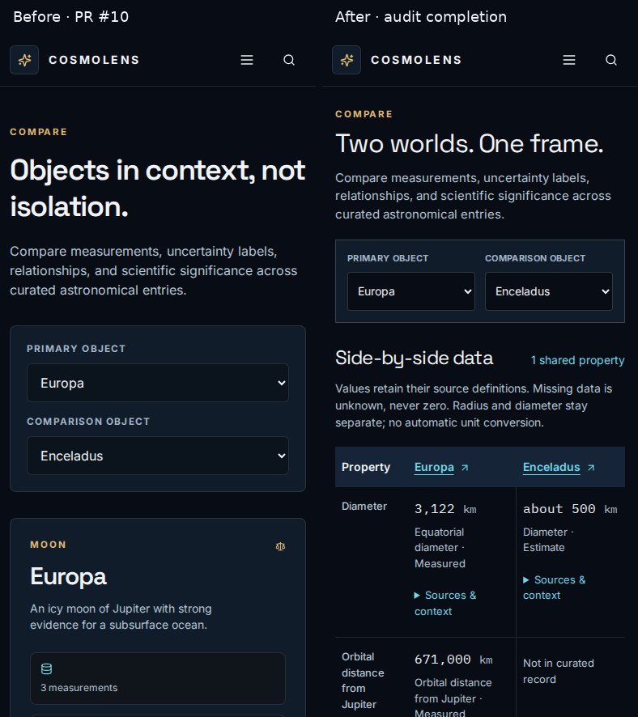

## my-cosmos · desktop

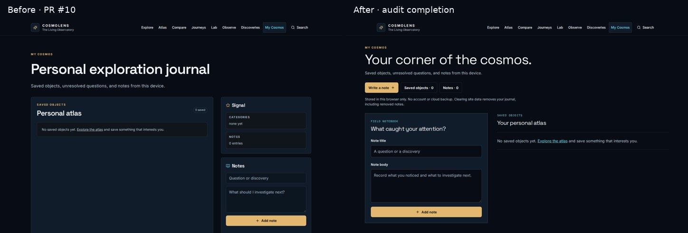

## my-cosmos · mobile

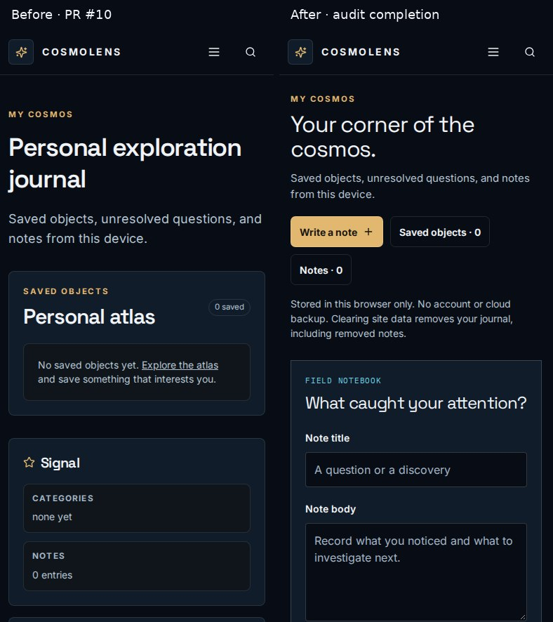

## journeys-dark-matter-evidence · desktop

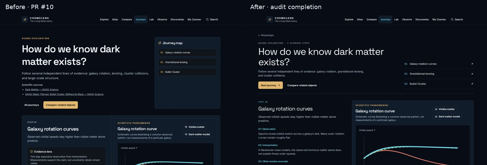

## journeys-dark-matter-evidence · mobile

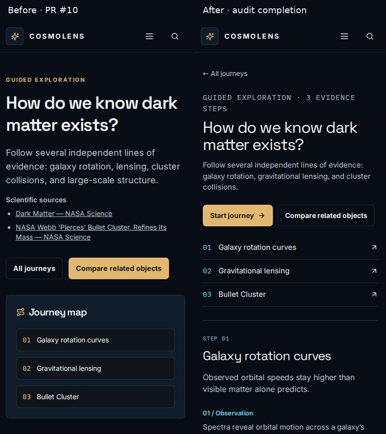

## journeys-life-of-a-star · desktop

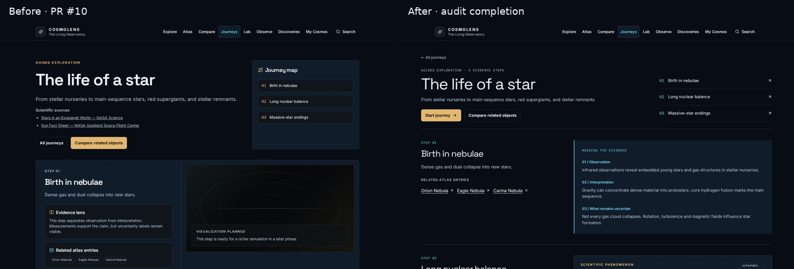

## journeys-life-of-a-star · mobile

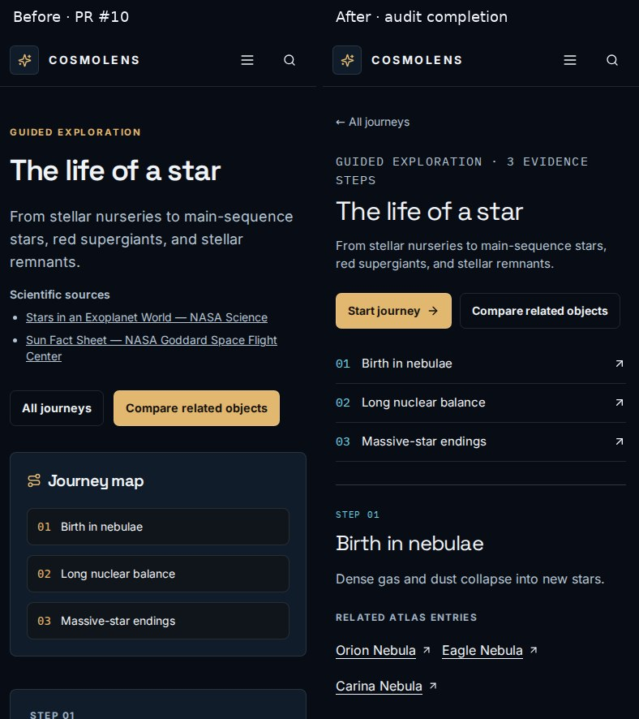

## journeys-universe-expansion · desktop

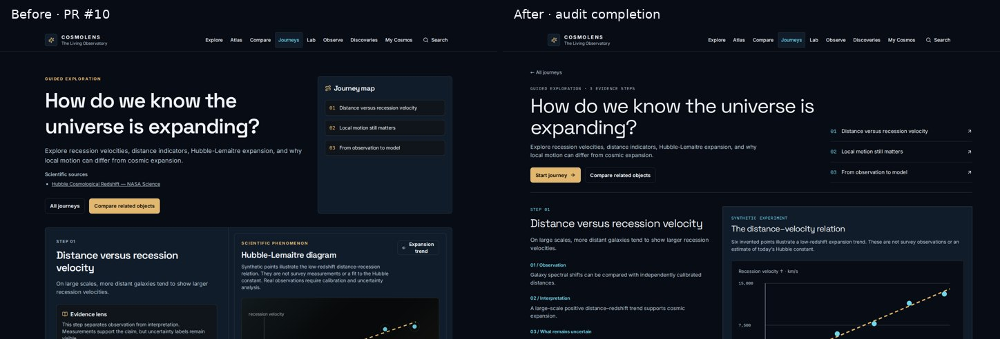

## journeys-universe-expansion · mobile

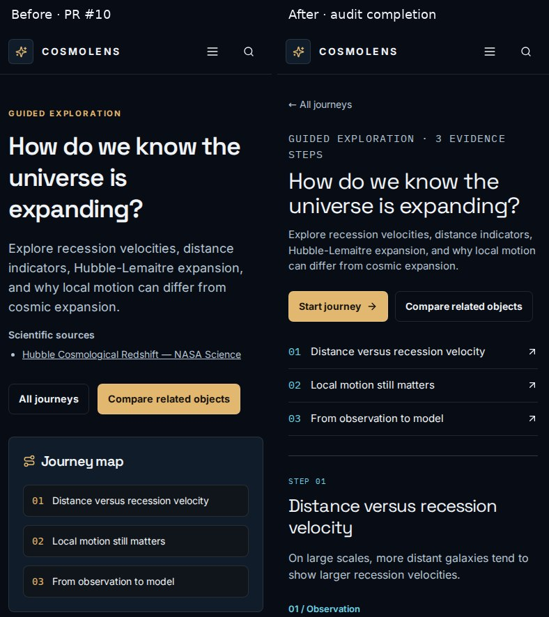

## discoveries · desktop

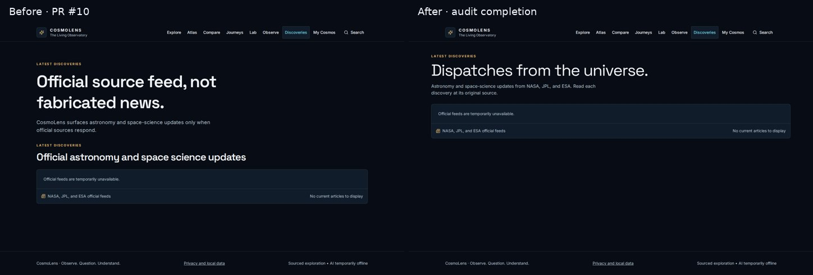

## discoveries · mobile

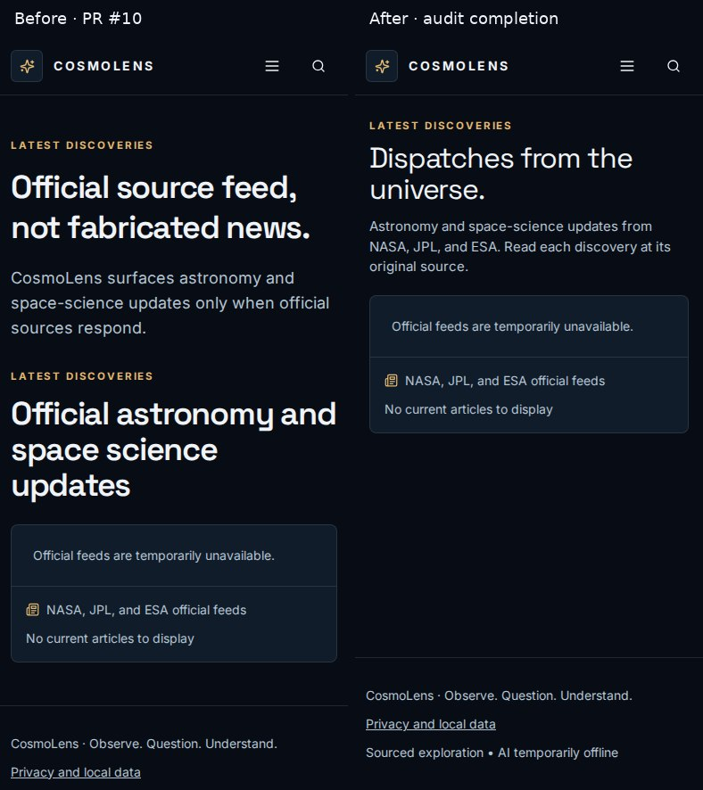
