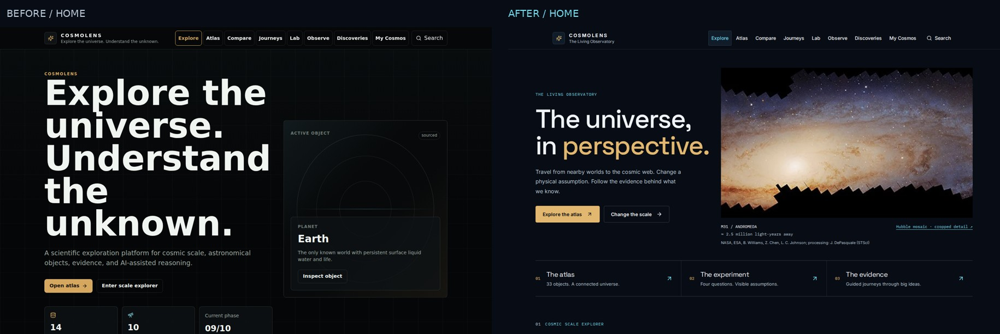
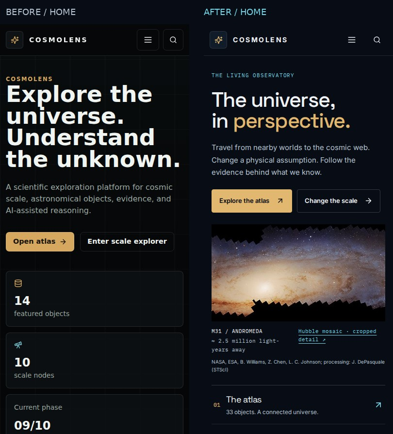
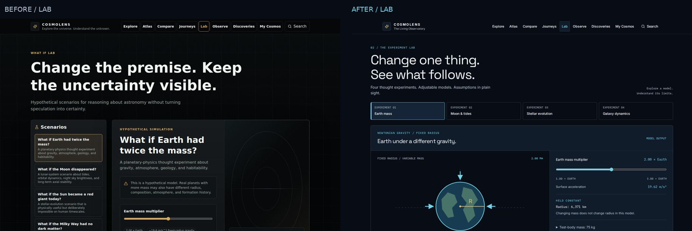
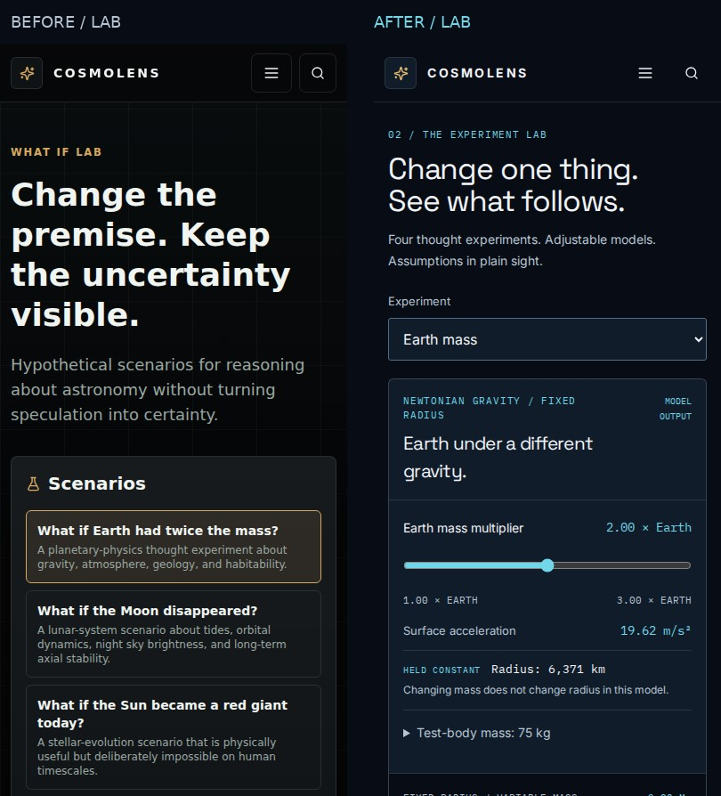
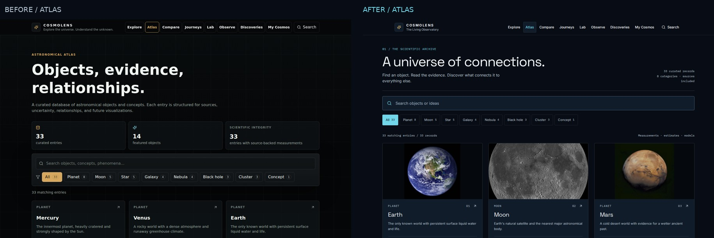
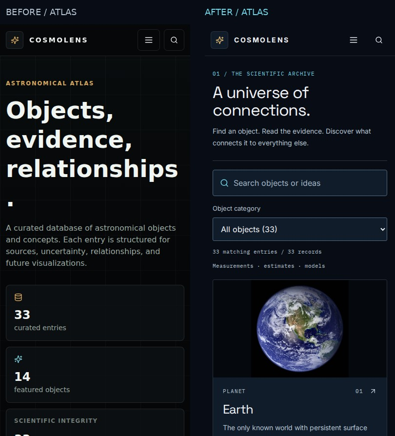

# Before / after review

The baseline is main `f30d536e222eb6fe6272181c9db2bb63ee97eab0`. Capture conditions are identical: local production build, Chromium, reduced motion, deterministic APOD/news fallback fixtures, loaded local fonts and images.

The complete matrix has viewport and full-page PNGs at 1440×900, 1024×768, 390×844, 360×800, 768×1024 and 1280×900 for Home, Lab and Atlas. Before and after manifests record capture dimensions and exceptions. The PR's `browser-results` CI artifact also includes the current after matrix and genuine 200% browser zoom evidence.

Review priority: the first viewport on mobile; Scale diagram/readout separation; Lab at 1024 px; readable Atlas search, filters, metadata and source credits. Live feeds are intentionally not used for a reproducible visual comparison.

## Home

## Lab

## Atlas

